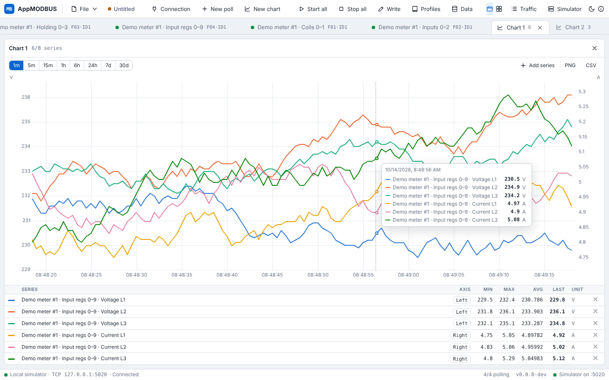
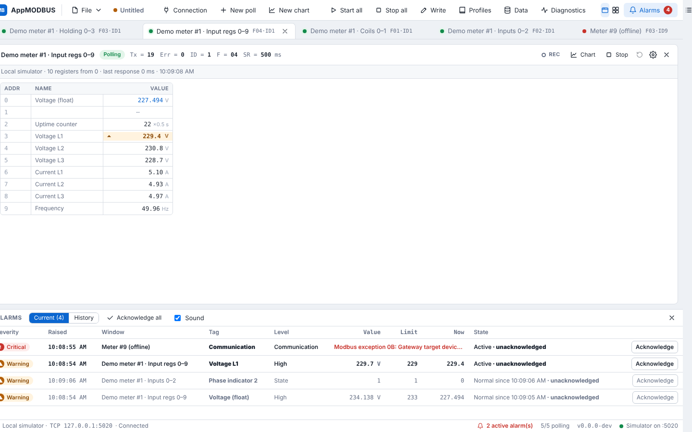
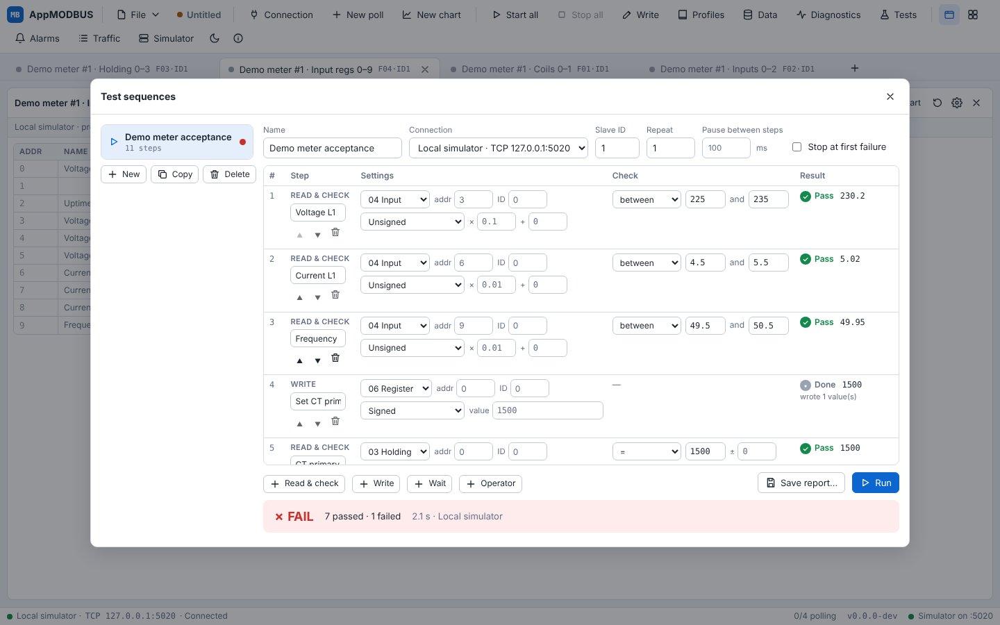
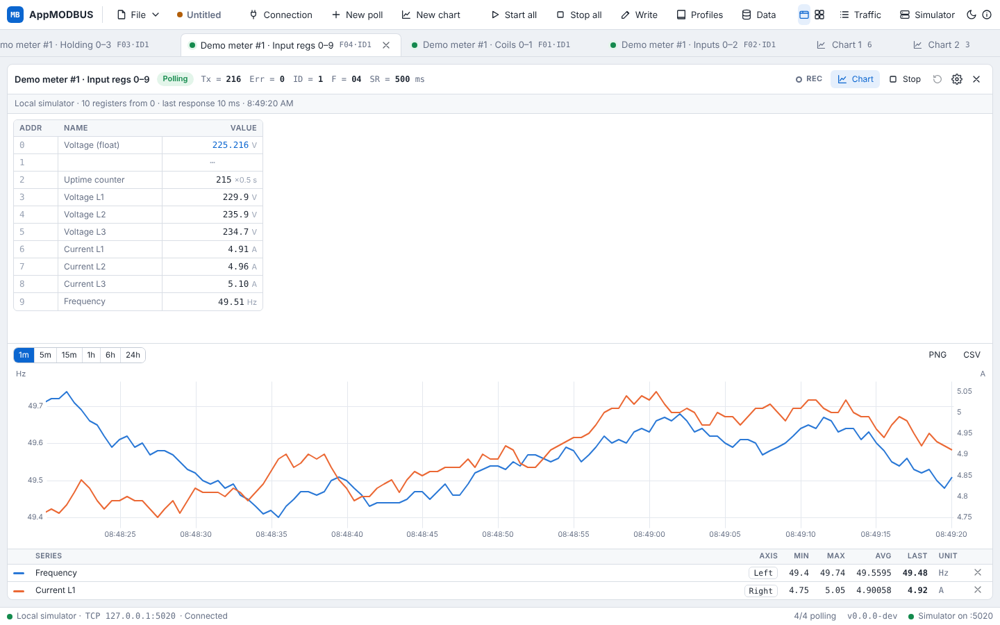
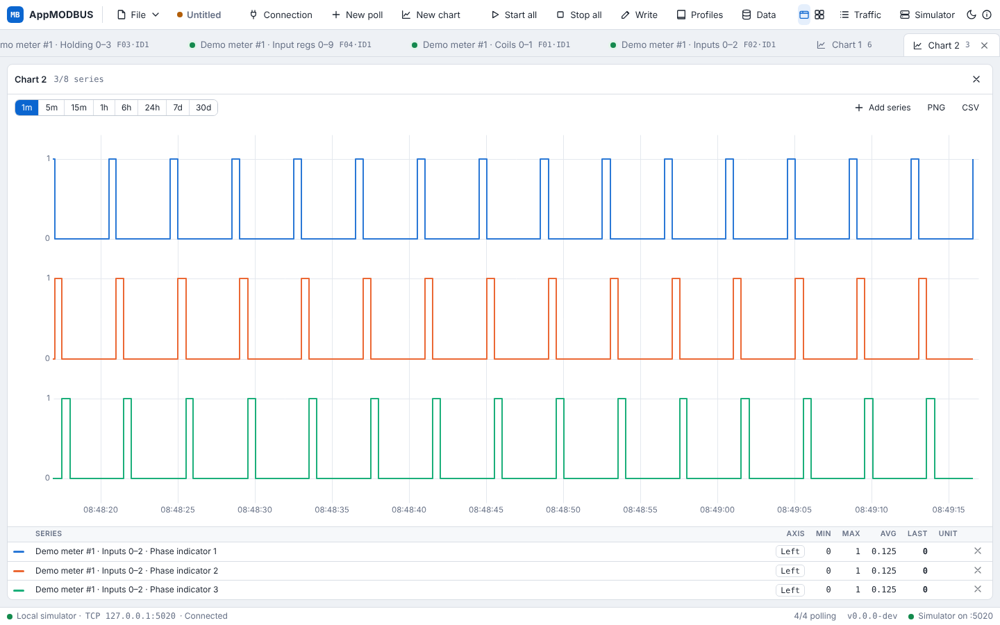
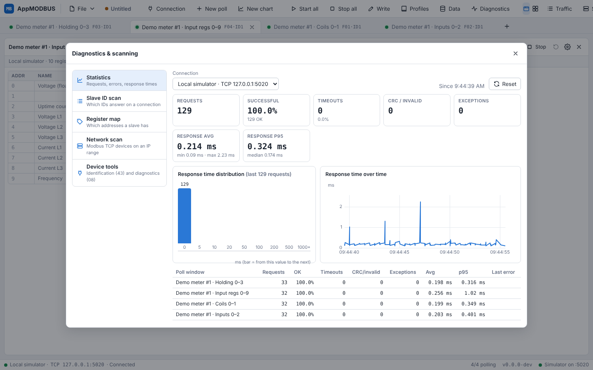
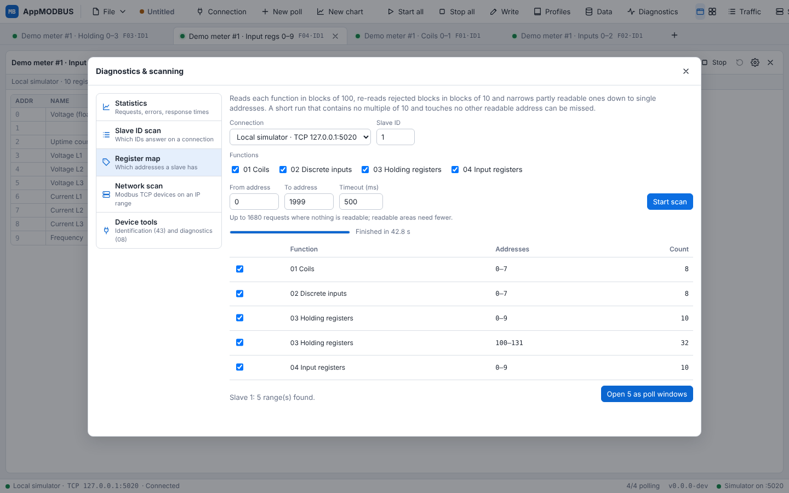

# Modbus Studio

A cross-platform Modbus master (in the spirit of Modbus Poll) with a built-in slave simulator.
It runs as a native desktop app on Windows, macOS and Linux and is written in **Go** using **Wails v2**,
with a **React + TypeScript** UI.


## Features

| Area | Details |
| --- | --- |
| Connections | Modbus RTU and Modbus ASCII (serial), Modbus TCP/IP, Modbus UDP/IP, RTU over TCP, ASCII over TCP, RTU over UDP |
| Serial settings | Any port, 1200–921600 baud, 7/8 data bits, N/E/O parity, 1/2 stop bits; t3.5 inter-frame timing for RTU, ':' … CR LF framing with LRC for ASCII |
| Poll windows | Any number of windows, each with its own slave ID, function, address, quantity and scan rate, shown as tabs or tiled side by side |
| Read functions | 01 Read Coils, 02 Read Discrete Inputs, 03 Read Holding Registers, 04 Read Input Registers |
| Write functions | 05, 06, 15, 16: double-click a cell, or use the **Write** dialog |
| Other functions | 23 Read/Write Multiple Registers (Write dialog), 08 Diagnostics, 43/14 Read Device Identification |
| Data formats | Signed, Unsigned, Hex, Binary; 32-bit Long / Unsigned Long / Float and 64-bit Long64 / Double, each in all four byte orders (AB CD, CD AB, BA DC, DC BA); set per window or per cell (right-click) |
| Addressing | Protocol (base 0) or PLC (base 1) per window |
| Diagnostics | Tx / Err counters, timeout, CRC and exception reporting, response time. **Diagnostics** window: per-connection and per-window statistics (timeouts, CRC errors, exceptions by code, min/avg/p95/max response time), response-time histogram and chart |
| Scanning | Slave ID scan (1–247) on any connection; register map probe (which addresses of functions 01–04 a slave answers, then open them as poll windows); Modbus TCP network scan of an IP range with unit IDs and device identification |
| Device tools | Function 43/14 Read Device Identification (basic, regular, extended); function 08 echo test and serial-line counters (read / clear) |
| Traffic log | Live Tx/Rx frames in hex (ASCII frames as text) with timestamps; pause, filter, clear, save to file |
| Simulator | Built-in Modbus slave (every connection type above) with an editable data table, optional live demo values, optional valid-address ranges per table, function 08 counters and 43/14 identification |
| Workspaces | Save/open `.mbw` files (connections, windows, formats, layout, simulator data); recent list; session autosave and restore on start-up with polling stopped; prompts to remap missing serial ports |
| Tags & profiles | Name, gain/offset scaling and units per register; device profiles (bundled, personal and shared-folder) applied to any slave ID; import register maps from CSV/Excel with Modicon address detection |
| Alarms | High-high / high / low / low-low limits with deadband per tag (in engineering units), bit state alarms, and a communication alarm after 3 failed reads. Alarm cells are coloured and marked; the alarm list shows severity, value, limit and live value, with acknowledge (single or all) and an optional sound. History is logged per day and can be exported to CSV; limits travel with workspaces and device profiles |
| Test sequences | **Tests** window: step lists of reads with checks (between, =, ≠, <, ≤, >, ≥ with tolerance and scaling), writes, waits and operator prompts; repeat, stop at first failure, pause between steps; per-step pass/fail with values, a PASS/FAIL verdict and a CSV report. Sequences are saved in the workspace |
| Recording | **REC** per poll window stores values (in engineering units) on disk; Data management: retention (default 30 days), size cap (default 2 GB, oldest first), storage folder, export to CSV/Excel, delete by series or date range |
| Charts | Chart tabs that combine up to 8 registers from any poll windows, plus an inline chart under each poll window. Left and right Y axes (one per unit), step lanes for coils and discrete inputs, min/max/avg/last per line, crosshair tooltip, drag to zoom, PNG and CSV export. Ranges from 1 minute to 30 days; 1 hour and longer also draw recorded history |
| Themes | Light and dark |
| Updates | Checks GitHub Releases on startup, offers one-click install & restart, Stable/Beta channels; every package is verified with an Ed25519-signed SHA-256 list ([docs/UPDATES.md](docs/UPDATES.md)) |

Several poll windows can share one connection. Requests are queued per connection, so windows
never collide on an RS-485 bus, and "Delay between polls" gives slow slaves time to turn around.







<p>
  
  
</p>

<p>
  
  
</p>

<p>
  
  
</p>

## Quick start

1. Launch Modbus Studio and click **Try with the built-in simulator**. This starts a slave on
   `127.0.0.1:5020`, connects to it and opens three poll windows.
2. Double-click a holding register or coil to write it. Right-click a register to change its format,
   name it, or add it to a chart. **Chart** in a window's title bar shows its values over time.
3. To use real hardware, open **Connection**, pick a type (serial port or IP address), then add a window
   with **New poll**.

## Installing

Download from the [latest release](https://github.com/elmnaveen/AppMODBUS/releases/latest):

| System | File |
| --- | --- |
| Windows 10/11 | `AppMODBUS-windows-amd64-installer.exe` (or the portable `AppMODBUS-windows-amd64.exe`) |
| macOS | `AppMODBUS-macos-universal.zip` (Intel and Apple Silicon) |
| Ubuntu 18.04, 20.04, 22.04 | `AppMODBUS-ubuntu-18.04-to-22.04-amd64.deb` |
| Ubuntu 24.04 and newer | `AppMODBUS-ubuntu-24.04-amd64.deb` |
| Other Linux (portable) | `AppMODBUS-linux-amd64.tar.gz` (needs WebKitGTK 4.1) |

On Ubuntu, double-click the `.deb` or run `sudo apt install ./AppMODBUS-ubuntu-*.deb`. apt installs the
WebKitGTK dependency, and Modbus Studio appears in the app menu. To use serial ports, add yourself to the
`dialout` group once: `sudo usermod -aG dialout $USER`, then log out and in again.

Installed copies update themselves (see [docs/UPDATES.md](docs/UPDATES.md)). A `.deb` installation is
updated with the new `.deb` after a password prompt.

## Building from source

Requirements: Go 1.23+, Node 20+, and the Wails CLI:

```sh
go install github.com/wailsapp/wails/v2/cmd/wails@v2.10.1
```

Platform prerequisites:

- **Windows:** WebView2 runtime (built into Windows 10/11). Install NSIS to build the installer.
- **macOS:** Xcode command line tools.
- **Linux:** `sudo apt install libgtk-3-dev libwebkit2gtk-4.1-dev`

```sh
wails dev                          # live-reload development
wails build                        # Windows / macOS -> build/bin/
wails build -tags webkit2_41       # Linux (Ubuntu 24.04+, WebKitGTK 4.1)
wails build -nsis                  # Windows installer
```

Run the tests with `go test -race ./internal/...`. The serial RTU test uses `socat` to create a
virtual serial cable and is skipped if `socat` is not installed.

CI (`.github/workflows/build.yml`) runs the tests and builds Windows (exe + NSIS installer),
macOS (universal .app) and Linux binaries on every push. Running the workflow with a version (Actions → Build → Run workflow), or pushing a `v*` tag, publishes a GitHub release with
signed checksums, which installed copies pick up as an update. See [docs/UPDATES.md](docs/UPDATES.md) for the one-time
signing-key setup.

## Project layout

```
main.go, app.go          Wails entry point and the bindings exposed to the UI
internal/modbus          Protocol: PDUs, CRC, RTU/MBAP framing, serial/TCP/UDP transports, client
internal/datafmt         Register <-> value conversion for every display format and byte order
internal/engine          Connections, poll windows (one goroutine each), writes, traffic batching
internal/simulator       Modbus slave: data store, request handler, TCP/UDP/serial servers
internal/update          Release discovery, signature/checksum verification, self-install
internal/workspace       Workspace (.mbw) file format and session autosave
internal/profile         Device profiles, profile library, CSV/xlsx register-map import
internal/recorder        On-disk time series of recorded values, retention, CSV/xlsx export
internal/settings        Persisted user preferences
internal/version         Build version, injected by CI
cmd/updatekey            Generates the release signing key; signs and verifies checksums
frontend/src             React UI (poll windows, dialogs, traffic log, simulator panel)
frontend/src/charts      Charts: live buffer, history merge, uPlot rendering
```

## Ideas for later

Bundled Elmeasure meter profiles, scripting beyond step lists, and OPC UA / MQTT forwarding.
