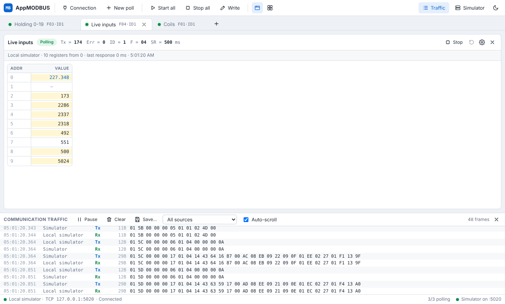
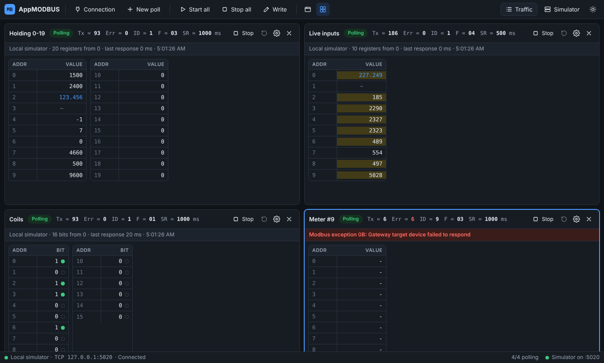
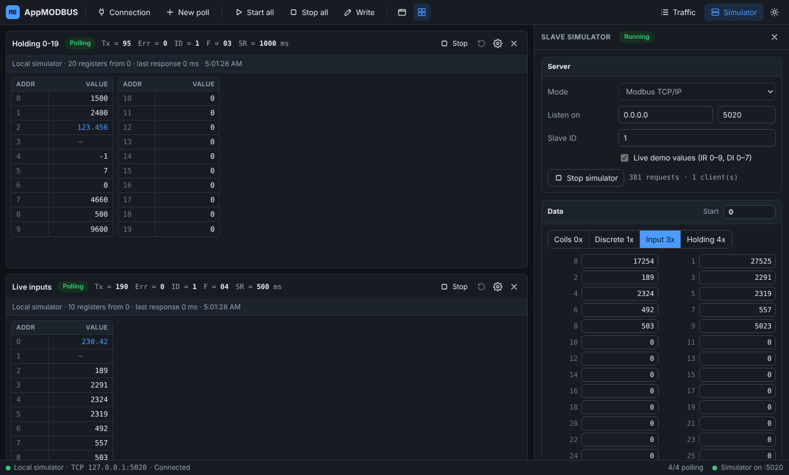

# AppMODBUS

A cross-platform Modbus master (in the spirit of Modbus Poll) with a built-in slave simulator.
It runs as a native desktop app on Windows, macOS and Linux and is written in **Go** using **Wails v2**,
with a **React + TypeScript** UI.



## Features (v0.1)

| Area | Details |
| --- | --- |
| Connections | Modbus RTU (serial), Modbus TCP/IP, RTU over TCP, RTU over UDP |
| Serial settings | Any port, 1200–921600 baud, 7/8 data bits, N/E/O parity, 1/2 stop bits; t3.5 inter-frame timing |
| Poll windows | Any number of windows, each with its own slave ID, function, address, quantity and scan rate, shown as tabs or tiled side by side |
| Read functions | 01 Read Coils, 02 Read Discrete Inputs, 03 Read Holding Registers, 04 Read Input Registers |
| Write functions | 05, 06, 15, 16: double-click a cell, or use the **Write** dialog |
| Data formats | Signed, Unsigned, Hex, Binary; 32-bit Long / Unsigned Long / Float and 64-bit Long64 / Double, each in all four byte orders (AB CD, CD AB, BA DC, DC BA); set per window or per cell (right-click) |
| Addressing | Protocol (base 0) or PLC (base 1) per window |
| Diagnostics | Tx / Err counters, timeout, CRC and exception reporting, response time |
| Traffic log | Live Tx/Rx frames in hex with timestamps; pause, filter, clear, save to file |
| Simulator | Built-in Modbus slave (TCP, RTU over TCP/UDP, serial RTU) with an editable data table and optional live demo values |
| Workspaces | Save/open `.mbw` files (connections, windows, formats, layout, simulator data); recent list; session autosave and restore on start-up with polling stopped; prompts to remap missing serial ports |
| Tags & profiles | Name, gain/offset scaling and units per register; device profiles (bundled, personal and shared-folder) applied to any slave ID; import register maps from CSV/Excel with Modicon address detection |
| Themes | Light and dark |
| Updates | Checks GitHub Releases on startup, offers one-click install & restart, Stable/Beta channels; every package is verified with an Ed25519-signed SHA-256 list ([docs/UPDATES.md](docs/UPDATES.md)) |

Several poll windows can share one connection. Requests are queued per connection, so windows
never collide on an RS-485 bus, and "Delay between polls" gives slow slaves time to turn around.

<p>
  
  
</p>

## Quick start

1. Launch AppMODBUS and click **Try with the built-in simulator**. This starts a slave on
   `127.0.0.1:5020`, connects to it and opens three poll windows.
2. Double-click a holding register or coil to write it. Right-click a register to change its format.
3. To use real hardware, open **Connection**, pick a type (serial port or IP address), then add a window
   with **New poll**.

## Building from source

Requirements: Go 1.23+, Node 20+, and the Wails CLI:

```sh
go install github.com/wailsapp/wails/v2/cmd/wails@v2.10.1
```

Platform prerequisites:

- **Windows:** WebView2 runtime (built into Windows 10/11). Install NSIS to build the installer.
- **macOS:** Xcode command line tools.
- **Linux:** `sudo apt install libgtk-3-dev libwebkit2gtk-4.1-dev`

```sh
wails dev                          # live-reload development
wails build                        # Windows / macOS -> build/bin/
wails build -tags webkit2_41       # Linux (Ubuntu 24.04+, WebKitGTK 4.1)
wails build -nsis                  # Windows installer
```

Run the tests with `go test -race ./internal/...`. The serial RTU test uses `socat` to create a
virtual serial cable and is skipped if `socat` is not installed.

CI (`.github/workflows/build.yml`) runs the tests and builds Windows (exe + NSIS installer),
macOS (universal .app) and Linux binaries on every push. Pushing a `v*` tag publishes a GitHub release with
signed checksums, which installed copies pick up as an update. See [docs/UPDATES.md](docs/UPDATES.md) for the one-time
signing-key setup.

## Project layout

```
main.go, app.go          Wails entry point and the bindings exposed to the UI
internal/modbus          Protocol: PDUs, CRC, RTU/MBAP framing, serial/TCP/UDP transports, client
internal/datafmt         Register <-> value conversion for every display format and byte order
internal/engine          Connections, poll windows (one goroutine each), writes, traffic batching
internal/simulator       Modbus slave: data store, request handler, TCP/UDP/serial servers
internal/update          Release discovery, signature/checksum verification, self-install
internal/workspace       Workspace (.mbw) file format and session autosave
internal/profile         Device profiles, profile library, CSV/xlsx register-map import
internal/settings        Persisted user preferences
internal/version         Build version, injected by CI
cmd/updatekey            Generates the release signing key; signs and verifies checksums
frontend/src             React UI (poll windows, dialogs, traffic log, simulator panel)
```

## Planned next (v2 ideas)

Real-time charts with recording and data management, Modbus ASCII,
Modbus UDP (MBAP) and function 23 (read/write multiple registers).
